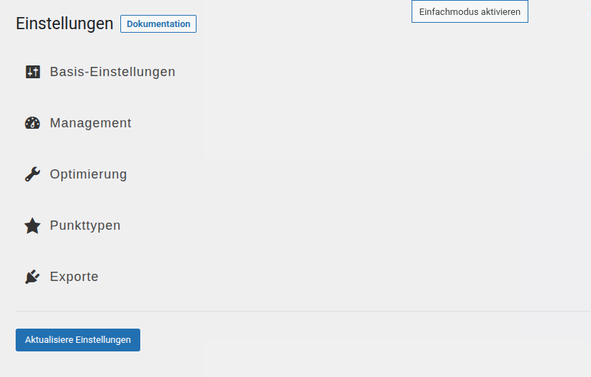
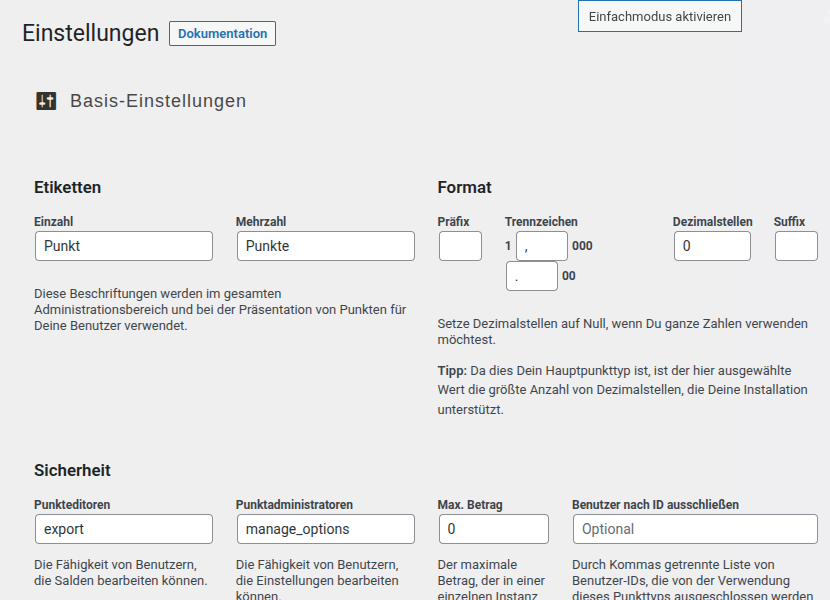

# BoniPress-Einstellungen

Unter **BoniPress → Einstellungen** legst Du fest, wie Deine Punkte heißen, dargestellt und verwaltet werden. Öffne einen Abschnitt durch einen Klick auf seine Überschrift. Änderungen werden erst mit **Aktualisiere Einstellungen** gespeichert.

## Basis-Einstellungen

* **Etiketten:** Lege Einzahl und Mehrzahl fest, zum Beispiel „Punkt“ und „Punkte“. Diese Bezeichnungen erscheinen im Administrationsbereich und bei der Darstellung für Benutzer.
* **Format:** Präfix und Suffix ergänzen die Punktzahl. Tausender- und Dezimaltrennzeichen sowie Dezimalstellen bestimmen ihre Darstellung. Für ganze Punkte setze die Dezimalstellen auf `0`. Beim Hauptpunkttyp bestimmt dieser Wert auch die größte unterstützte Anzahl an Dezimalstellen.
* **Sicherheit:** Die Fähigkeiten für Punkteditoren und Punktadministratoren bestimmen, wer Guthaben bearbeiten beziehungsweise Einstellungen ändern darf. Ändere sie nur, wenn Du die entsprechenden Benutzerrechte eingerichtet hast, damit Du Dich nicht aussperrst. Ein Maximalbetrag begrenzt eine einzelne Auszahlung.
* **Ausschlüsse:** Über Benutzer-IDs oder die jeweiligen Kontrollkästchen kannst Du Benutzer, Punkteditoren oder Punktadministratoren von diesem Punkttyp ausschließen.
* **Andere Einstellungen:** Entscheide, ob Protokolleinträge beim Löschen eines Benutzers ebenfalls entfernt werden sollen.

## Management und Punkttypen

Unter **Management** findest Du Informationen und Aktionen für die Protokolltabelle und die gespeicherten Guthaben. Lösch- und Zurücksetzungsaktionen können Daten unwiederbringlich entfernen: Erstelle vorher eine vollständige Sicherung und prüfe genau, was die jeweilige Aktion betrifft.

Unter **Punkttypen** kannst Du zusätzliche Typen anhand eines Metaschlüssels und einer Beschriftung anlegen. Der Hauptpunkttyp lässt sich dort nicht löschen. Vor dem Löschen anderer Typen solltest Du Guthaben und Einstellungen sichern.

## Optimierung und Exporte

Unter **Optimierung** konfigurierst Du die Zwischenspeicherung von Verlauf und Bestenlisten sowie das automatische Löschen alter Protokolleinträge. Die Folgen erklärt die [Anleitung zur Optimierung](https://psource.eimen.net/wiki/bonipress-optimierung/).

Unter **Exporte** bestimmst Du unter anderem, wie Benutzer beim Export identifiziert werden. Für eine Sicherung derselben Website empfiehlt die Oberfläche die Benutzer-ID, für eine Übertragung auf eine andere Website die E-Mail-Adresse. Eine Anleitung zum Wiedereinlesen findest Du unter [Import](https://psource.eimen.net/wiki/bonipress-import/).

## Erster Funktionstest

1. Benenne und formatiere Deinen Punkttyp und speichere die Einstellungen.
2. Richte unter **Hooks** eine einfache Regel ein, etwa für Registrierungen oder Logins.
3. Führe die Aktion mit einem geeigneten Testkonto aus und überprüfe Guthaben und [Protokoll](https://psource.eimen.net/wiki/bonipress-protokoll/). Beachte dabei Ausschlüsse und Limits.

Die verfügbaren Abschnitte können sich je nach aktivierten Erweiterungen und Berechtigungen unterscheiden.
