# BoniPress-Erweiterungen

Erweiterungen ergänzen Dein Punktesystem um Funktionen, die Du nicht auf jeder Website benötigst. Öffne **BoniPress → Erweiterungen**, suche die gewünschte Karte und klicke auf **Aktivieren**. Mit **Deaktivieren** schaltest Du die Funktion wieder ab. Aktiviere nur, was Du benötigst.

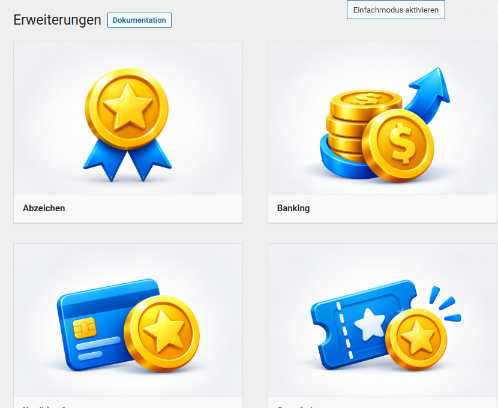

Nach der Aktivierung erscheinen je nach Erweiterung zusätzliche Menüpunkte, Einstellungen oder Shortcodes. Prüfe sie zunächst mit Testkonten. Bei Funktionen mit Kauf, automatischer Auszahlung oder Löschung empfiehlt sich vorher eine Sicherung.

## Abzeichen

Mit Abzeichen belohnst Du erreichte Ziele, etwa regelmäßige Besuche oder eine bestimmte Anzahl von Beiträgen.

1. Öffne **Abzeichen → Neues hinzufügen** und gib dem Abzeichen einen Namen.
2. Wähle im Bereich **Abzeichen Setup** ein Bild und lege die Voraussetzung für das erste Level fest. Wähle dazu den Punkttyp, die passende Referenz und die Anforderung. Mit **+** ergänzt Du weitere Voraussetzungen; mit **AND / OR** legst Du fest, wie sie zusammenwirken.
3. Optional kannst Du eine Punktebelohnung für das Level und deren Protokolltext eintragen. Mit **Level hinzufügen** ergänzt Du weitere Stufen.
4. Soll das Abzeichen nicht automatisch vergeben werden, wähle **Dieses Abzeichen wird manuell vergeben**. Lege bei Bedarf auch ein Standardabzeichenbild fest und veröffentliche das Abzeichen.
5. Teste mit einem Benutzerkonto, ob die Voraussetzungen und die Vergabe wie gewünscht funktionieren.

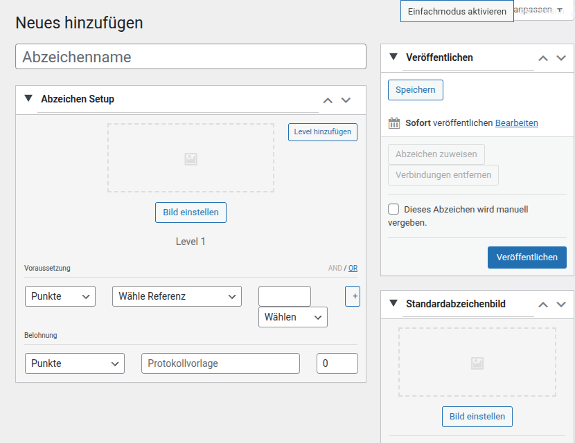

Unter **BoniPress → Einstellungen → Abzeichen** siehst Du verfügbare Integrationen und Shortcodes. `[bonips_my_badges]` zeigt die eigenen Abzeichen, `[bonips_badges]` eine Abzeichenübersicht. Welche Referenzen und Integrationen verfügbar sind, hängt von den aktiven Hooks und Plugins ab.

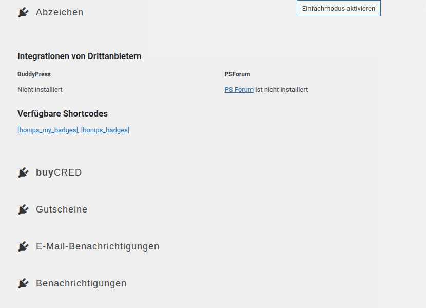

## Banking

Banking bietet wiederkehrende Auszahlungen und Zinsen auf Guthaben. Nach der Aktivierung der Erweiterung findest Du unter **Banking** die verfügbaren Bankdienstleistungen. Das Aktivieren der Erweiterung allein bedeutet nicht, dass Du alle einzelnen Dienste verwenden musst.

Für Zinsen öffne **Zinseszins** und prüfe vor dem Aktivieren:

1. Den täglichen Berechnungsplan und den Auszahlungsplan.
2. Zinssatz, Auszahlungshäufigkeit und erforderliches Mindestguthaben.
3. Den Text für den Protokolleintrag.
4. Aktiviere den Dienst erst, wenn die Werte stimmen, und speichere die Einstellungen.

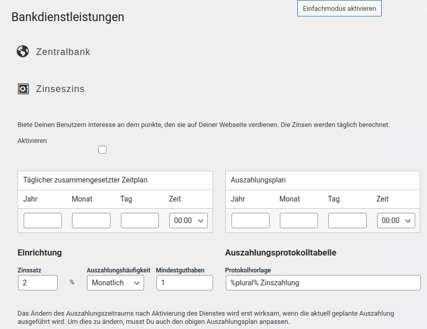

Bei wiederkehrenden Auszahlungen prüfe ebenso Zeitplan, Beträge und Einschränkungen. Änderungen am Auszahlungszeitraum werden laut Oberfläche erst nach der aktuell geplanten Auszahlung wirksam, sofern Du den Auszahlungsplan nicht ebenfalls anpasst. Automatische Buchungen verändern echte Guthaben. Teste deshalb zunächst mit Testkonten und beachte, dass geplante Vorgänge von der Cron-Ausführung Deiner Website abhängen.

## Kreditkauf

Mit Kreditkauf können Benutzer Punkte kaufen. Du wählst verkäufliche Punkttypen, Grenzen und Zahlungsarten. Eine ausführliche Anleitung zu Einrichtung und Zahlungsanbietern findest Du unter [Kreditkauf und Zahlungsarten](https://psource.eimen.net/wiki/bonipress-kreditkauf/).

## Gutscheine

Speichere nach der Aktivierung zunächst die BoniPress-Einstellungen. Erstelle dann unter **Gutscheine → Neuer Gutschein** einen Gutscheincode:

1. Trage Code und Punktewert ein und wähle den Punkttyp.
2. Lege bei Bedarf ein Ablaufdatum, ein Gesamtlimit und ein Limit pro Benutzer fest.
3. Schränke optional ein, welches Mindest- oder Maximalguthaben ein Benutzer zum Einlösen haben darf.
4. Veröffentliche den Gutschein und stelle das Einlöseformular für angemeldete Benutzer mit `[bonips_load_coupon]` auf einer Seite bereit.

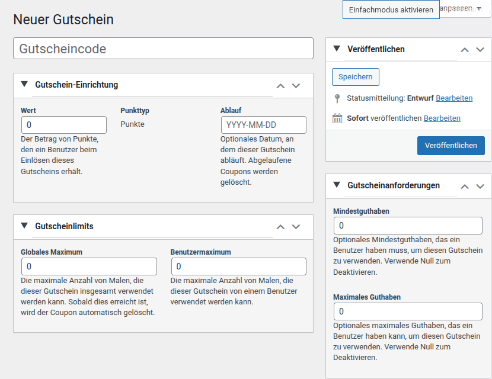

Unter **BoniPress → Einstellungen → Gutscheine** kannst Du die Meldungen für ungültige oder abgelaufene Codes, Guthabengrenzen und ausgeschlossene Benutzer anpassen. Speichere anschließend die Einstellungen.

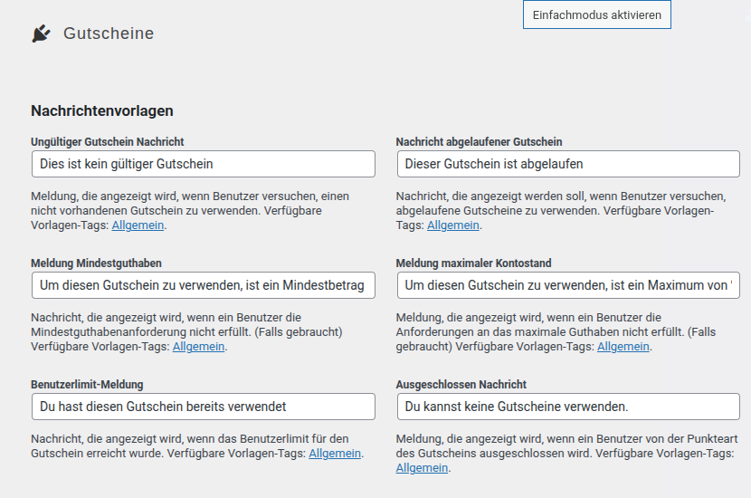

Teste die Einlösung und die festgelegten Grenzen. Die Oberfläche weist darauf hin, dass abgelaufene Gutscheine und Gutscheine nach Erreichen des Gesamtlimits gelöscht werden. Gib Codes nur an die vorgesehenen Empfänger weiter.

## E-Mail-Benachrichtigungen

Mit dieser Erweiterung kannst Du E-Mails für Punkteereignisse erstellen.

1. Öffne **BoniPress → Einstellungen → E-Mail-Benachrichtigungen**. Wähle einfaches Textformat oder HTML und den Versand sofort, stündlich oder täglich. Hinterlege die gewünschten Absender- und Antwortadressen sowie gegebenenfalls einen Standardinhalt und speichere.
2. Öffne **E-Mail Benachrichtigungen → Neue hinzufügen**. Gib Betreff und Nachricht ein.
3. Wähle im Bereich **E-Mail-Auslöser** das Ereignis, den Punkttyp und den Empfänger: Benutzer, Administrator oder beide.
4. Prüfe die weiteren E-Mail-Details und verfügbaren Vorlagen-Tags und veröffentliche die Benachrichtigung.
5. Löse das Ereignis zunächst mit einem Testkonto aus und kontrolliere Inhalt, Empfänger und Zustellung.

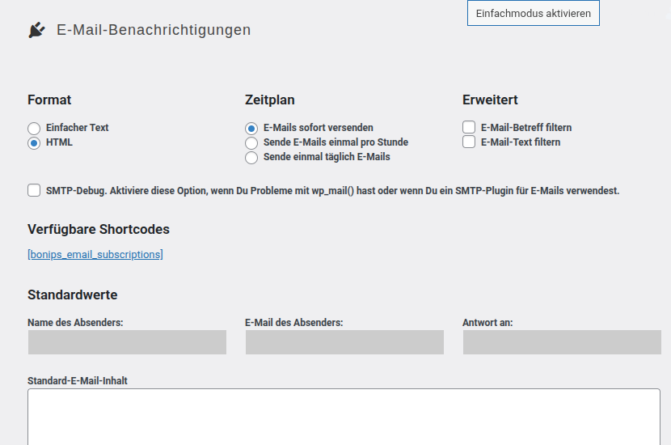

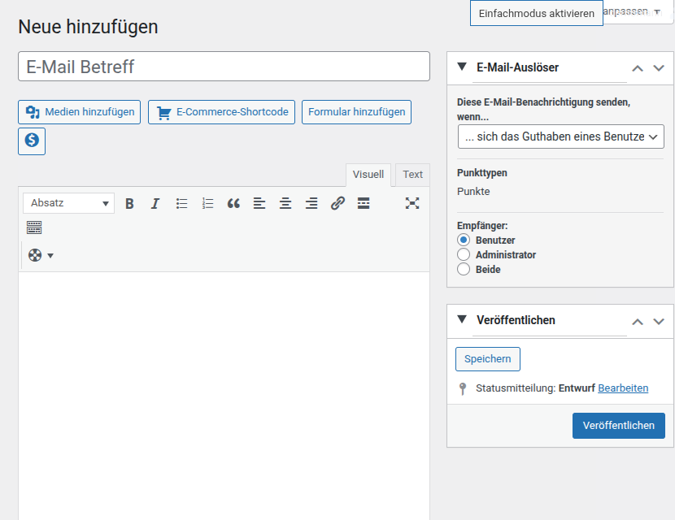

Der Shortcode `[bonips_email_subscriptions]` stellt die Abonnementverwaltung bereit. Berücksichtige bei Versand und Abonnements Einwilligung und Datenschutz. Geplanter Versand hängt von der Cron-Ausführung Deiner Website ab.

## Gateway: Mit Punkten bezahlen

Diese Erweiterung ermöglicht Zahlungen mit vorhandenem Punkteguthaben in unterstützten Shop- und Buchungssystemen. Aktiviere BoniPress Gateway und richte die BoniPress-Zahlungsart anschließend im jeweiligen Shop oder Buchungssystem ein. Prüfe Punkttyp, Umrechnung, Meldungen und Protokollvorlagen. Teste Bestellung, unzureichendes Guthaben und gegebenenfalls Stornierung, bevor Du die Zahlungsart freigibst.

Gateway ist nicht dasselbe wie **Kreditkauf**: Beim Gateway werden vorhandene Punkte ausgegeben, beim Kreditkauf werden Punkte gegen Geld erworben. Verfügbarkeit und Kompatibilität hängen vom eingesetzten Shop und dessen Version ab.

## Benachrichtigungen

Diese Erweiterung zeigt Benutzern Popup-Benachrichtigungen bei Punktegewinn oder -verlust. Öffne **BoniPress → Einstellungen → Benachrichtigungen** und passe Vorlage, Lebensdauer des Transients, Anzeigedauer und bei Bedarf das CSS an. Speichere die Einstellungen, löse eine Testbuchung aus und überprüfe, ob die Meldung sichtbar und verständlich ist.

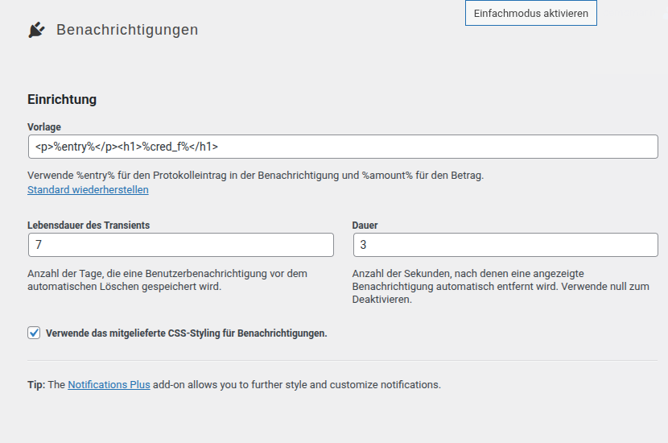

## Ränge

Mit Rängen kannst Du Mitglieder anhand von Punkteanforderungen einstufen.

1. Öffne **BoniPress → Einstellungen → Ränge** und wähle das Rangverhalten: manuelle Zuweisung, Einstufung nach aktuellem Guthaben oder nach Gesamtsaldo. Beim aktuellen Guthaben sind sowohl Auf- als auch Abstufungen möglich; bei Gesamtsalden bleiben erreichte höhere Ränge auch bei sinkendem Guthaben erhalten.
2. Lege bei Bedarf fest, ob Ränge öffentlich sind und wie sie sortiert werden. Speichere die Einstellungen.
3. Öffne **Ränge → Neues hinzufügen**, gib einen Titel und die minimale und maximale Punkteanforderung ein, wähle den Punkttyp und füge bei Bedarf ein Rang-Logo hinzu.
4. Veröffentliche den Rang und wiederhole die Schritte für die weiteren Stufen. Prüfe die Grenzen mit Testkonten, damit keine unbeabsichtigten Lücken oder Überschneidungen entstehen.

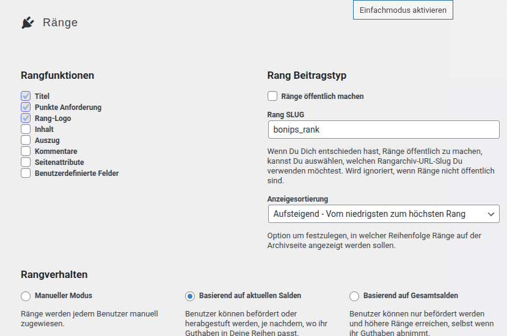

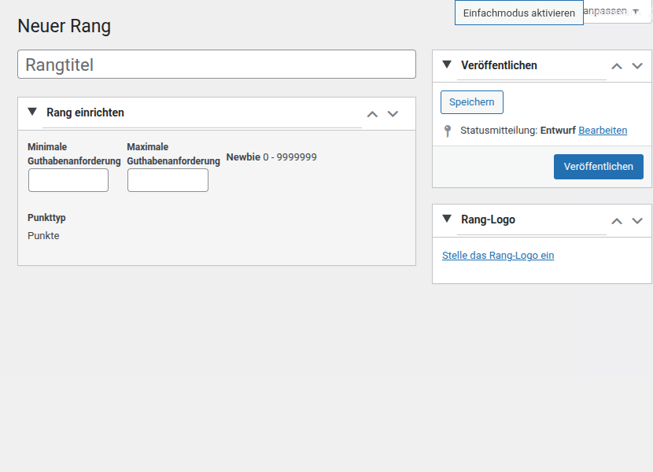

Manuell zugewiesene Ränge werden nicht automatisch geändert. Mit `[bonips_my_rank]` kannst Du den eigenen Rang anzeigen; weitere Shortcodes stehen in den Einstellungen.

## Inhalt verkaufen

Mit dieser Erweiterung können Benutzer Inhalte mit Punkten freischalten. Öffne **BoniPress → Einstellungen → Inhalt verkaufen**, wähle die erlaubten Beitragstypen und Punkttypen und prüfe Standardstatus, Standardpreis, Ablauf und gegebenenfalls Gewinnbeteiligung. Passe die Kauf-, Besucher- und Guthabenmeldungen an und speichere.

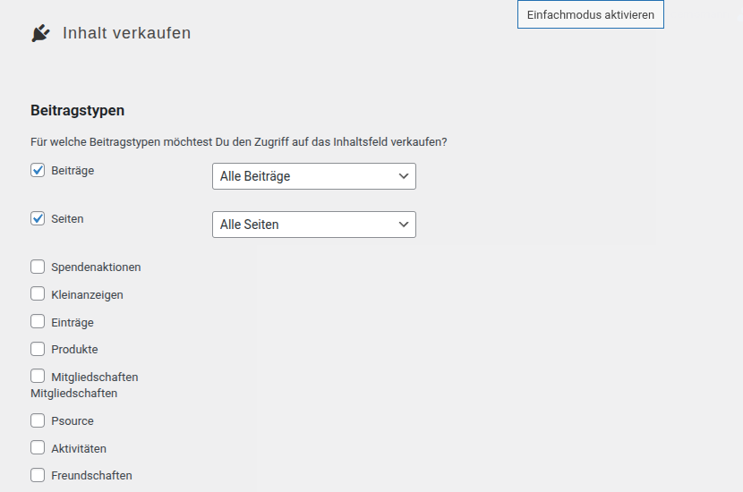

Im Inhaltseditor kannst Du einen ganzen Inhalt zum Verkauf anbieten; mit `[bonips_sell_this]` lässt sich ein Teilbereich verkaufen. Die Erweiterung benötigt das Protokoll.

Teste mit angemeldetem Käufer, ausreichendem und unzureichendem Guthaben sowie als Besucher, ob geschützte Inhalte und Meldungen wie erwartet erscheinen. Veröffentliche keine vertraulichen Inhalte, bevor Du den Schutz in Deiner konkreten Konfiguration geprüft hast.

## Statistiken

Die Erweiterung zeigt Auswertungen zu Punktebewegungen. Unter **BoniPress → Einstellungen → Statistiken** kannst Du Farben, Diagrammanimation, Bézier-Kurven und Cache-Intervalle einstellen und speichern.

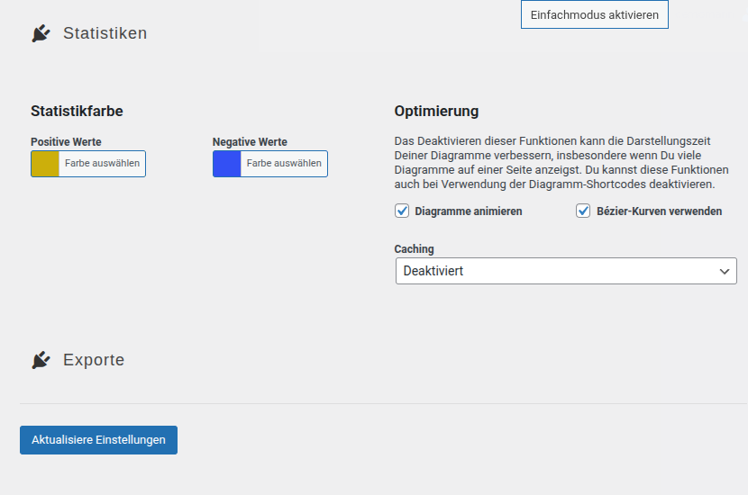

Für Darstellungen stehen beispielsweise `[bonips_chart_circulation]` und `[bonips_chart_gain_loss]` zur Verfügung. Protokollaufbewahrung und gewählter Zeitraum beeinflussen, welche historischen Daten für Auswertungen verfügbar sind.

## MarketPress

Die MarketPress-Erweiterung verbindet BoniPress mit MarketPress: Kunden können Punkte für Einkäufe erhalten und mit Punkten bezahlen. Voraussetzung ist eine passende MarketPress-Installation.

Für die Zahlung mit Punkten öffne in MarketPress **Einstellungen → Zahlungen** und richte die Zahlungsart **boniPS** ein. Dort kannst Du unter anderem den angezeigten Methodennamen, den Punkttyp und den Wechselkurs sowie Meldungen für Besucher und unzureichendes Guthaben festlegen. Bei einem reinen Punkteshop weist die Oberfläche darauf hin, denselben Punkttyp wie für die Shopwährung und den Wechselkurs 1 zu verwenden. Prüfe auch die Protokollvorlage und gegebenenfalls die Gewinnbeteiligung. Aktiviere die gewünschte Zahlungsart und speichere die MarketPress-Einstellungen.

Für Punktebelohnungen prüfe zusätzlich die verfügbaren MarketPress-Hooks unter **BoniPress → Hooks**. Teste eine Bestellung samt Guthaben und Protokoll, bevor Kunden die Funktion nutzen.

## Transaktionen

Mit Transaktionen können Benutzer Punkte an andere Mitglieder senden. Öffne **BoniPress → Einstellungen → Überweisungen** und prüfe die verfügbaren Punkttypen, Empfänger-Autovervollständigung und Nachrichtenlänge. Lege bei Bedarf ein tägliches, wöchentliches oder monatliches Limit und den entsprechenden Betrag fest. Passe die Protokollvorlagen und Meldungen an und speichere.

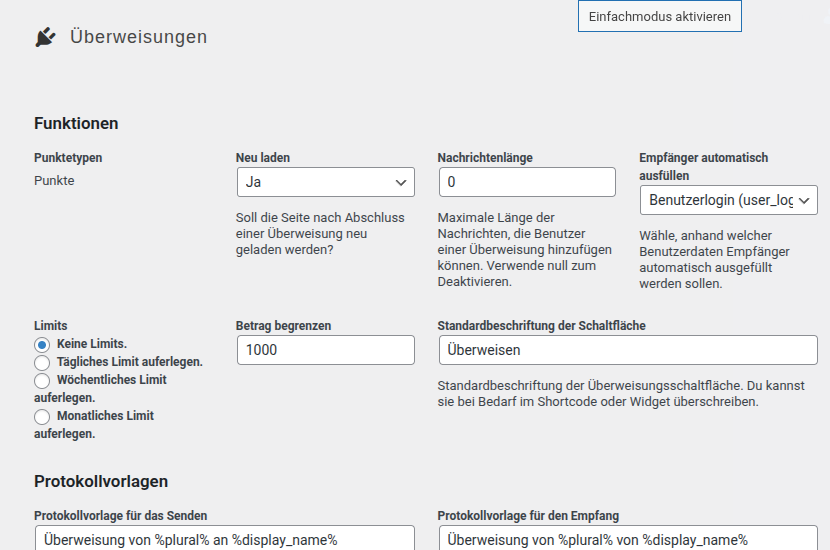

Stelle das Formular über `[bonips_transfer]` oder das BoniPress-Transfer-Widget bereit. Teste Sender und Empfänger, ausreichendes und unzureichendes Guthaben sowie die von Dir gesetzten Limits.
