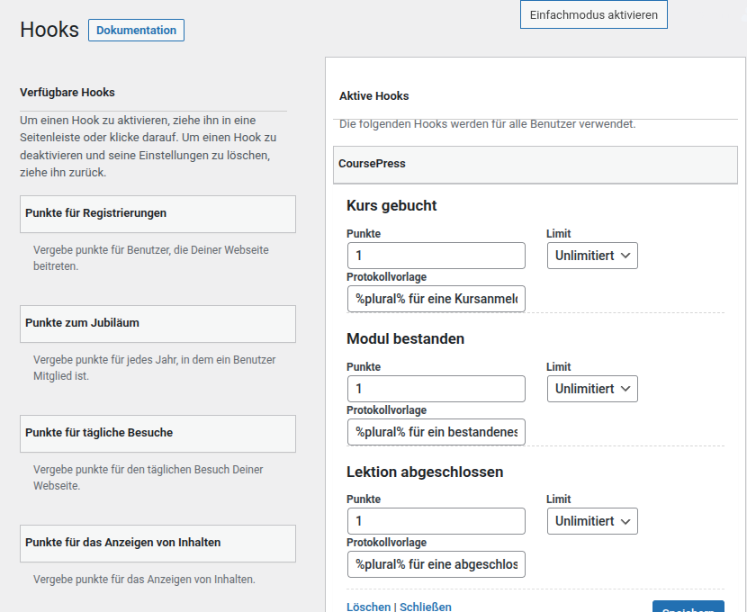

# Hooks: Punkte automatisch vergeben

Ein Hook verbindet eine Aktion auf Deiner Website mit einer Punktebuchung. So kannst Du zum Beispiel Registrierungen, Logins oder Kommentare belohnen. Die verfügbaren Hooks hängen auch von den installierten Plugins ab.

## Hook einrichten

1. Öffne **BoniPress → Hooks** und wähle, falls angeboten, den gewünschten Punkttyp.
2. Ziehe einen Hook aus **Verfügbare Hooks** nach **Aktive Hooks** oder klicke darauf und wähle den Zielbereich.
3. Öffne den aktiven Hook. Trage die gewünschten Punkte und gegebenenfalls Limits und Protokollvorlagen ein. Die verfügbaren Felder unterscheiden sich je nach Hook.
4. Klicke innerhalb des Hooks auf **Speichern**.
5. Teste die Aktion mit einem geeigneten Benutzerkonto und prüfe Guthaben und [Protokoll](https://psource.eimen.net/wiki/bonipress-protokoll/). Ausgeschlossene Benutzer erhalten keine Punkte.

Zum Deaktivieren ziehst Du den Hook zurück oder verwendest **Löschen** im geöffneten Hook. Dabei werden seine Einstellungen gelöscht. **Schließen** klappt ihn nur zu.

Ein Limit begrenzt, wie oft eine Buchung im gewählten Zeitraum oder Zusammenhang erfolgen darf. Lies die Beschreibung direkt am jeweiligen Feld: `0` bedeutet nicht bei jeder Einstellung dasselbe. Die Protokollvorlage bestimmt den Text der Buchung; verfügbare Platzhalter stehen unter dem jeweiligen Feld.

## Standard-Hooks

### Registrierungen und Jubiläum

**Registrierungen** vergibt Punkte, wenn ein Benutzer der Website beitritt. Lege Betrag und Protokollvorlage fest. **Jubiläum** belohnt jedes Mitgliedsjahr mit dem eingestellten Betrag. Prüfe bei einem Test auch, ob das Konto vom Punkttyp ausgeschlossen ist.

### Tägliche Besuche und Logins

**Tägliche Besuche** belohnt den täglichen Besuch der Website. **Logins** reagiert auf die Anmeldung und bietet ein Limit. Beide Regeln können gleichzeitig aktiv sein: Prüfe deshalb, ob Du beide Ereignisse getrennt belohnen möchtest.

### Inhalte ansehen

Für Beiträge, Seiten und andere verfügbare Inhaltstypen lassen sich Regeln getrennt festlegen. Es gibt Einstellungen für den betrachtenden Benutzer und den Inhaltsautor sowie deren Limits und Protokolltexte. Teste beide Rollen und beachte, dass ein reiner Seitenaufruf nicht mit dem Lesen des Inhalts gleichzusetzen ist.

### Inhalte veröffentlichen und in den Papierkorb verschieben

Lege für die jeweiligen Beitragstypen Betrag, Limit und Protokollvorlage fest. Der Hook für verworfene Inhalte reagiert auf das Verschieben in den Papierkorb; mit einem negativen Betrag kann ein Abzug eingestellt werden. Prüfe bei Deinem Ablauf insbesondere, was beim Wiederherstellen und erneuten Verschieben geschieht.

### Kommentare

Für **genehmigte Kommentare**, **Spam-Kommentare** und **Kommentare im Papierkorb** stehen getrennte Beträge und Protokollvorlagen zur Verfügung. Dabei können Mitglied und Inhaltsautor berücksichtigt werden. Für genehmigte Kommentare gibt es unter anderem Limits pro Beitrag und pro Tag. Teste auch Statuswechsel und Moderation, bevor Du die Regel produktiv einsetzt.

### Klicks auf Links

Der Hook berücksichtigt Links, die mit dem Shortcode `[bonips_link]` erzeugt wurden, nicht automatisch jeden Link der Website. Konfiguriere Betrag, Protokollvorlage und Limits. Die Hook-Einstellungen verweisen auf den verfügbaren Shortcode; prüfe einen eingerichteten Link mit einem Testkonto.

### Videos ansehen

Der Hook gilt für Videos, die mit `[bonips_video]` eingebettet wurden. Du kannst die Vergabe beim **Abspielen**, nach **vollständiger** Wiedergabe oder in einem **Intervall** wählen. Bei Intervallen legst Du die Sekunden fest. Die Toleranz darf laut Oberfläche nicht `0` sein, da durch Pufferung oder Wiedergabefehler Sekunden fehlen können. Teste die Wiedergabe und das Limit im verwendeten Browser.

### Empfehlungen

Für geworbene Besucher und Registrierungen gibt es getrennte Einstellungen. Unter **Empfehlungslinks** werden Beispiele und verfügbare Shortcodes angezeigt; ein IP-Limit kann wiederholte Vergaben begrenzen. Bei vorhandener BuddyPress-Integration lässt sich ein Empfehlungslink auch im Profil anzeigen. Teste Besuch und Registrierung mit getrennten Konten und achte auf Datenschutz bei der Nutzung von IP-Adressen.

## Wenn keine Punkte erscheinen

Prüfe, ob der richtige Punkttyp und Hook aktiv sind, die Änderungen im Hook gespeichert wurden und das Testkonto nicht ausgeschlossen ist. Kontrolliere Betrag, Limits und den tatsächlichen Ereignisablauf. Bei externen Integrationen muss zusätzlich das betreffende Plugin aktiv und kompatibel sein.
