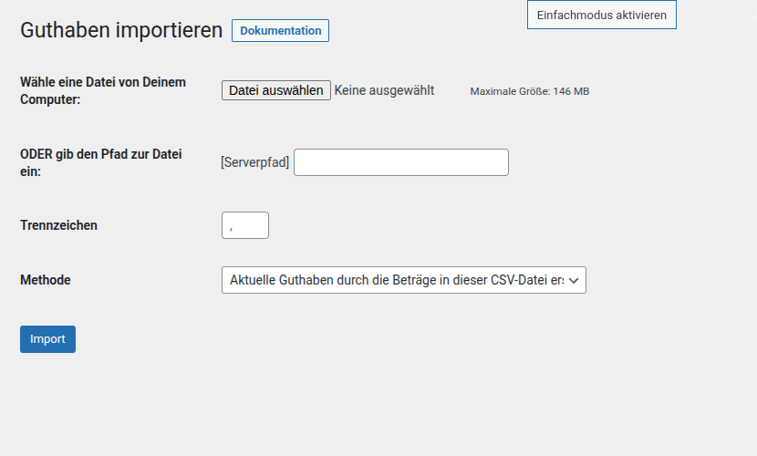

# Guthaben und Protokolle importieren

Die BoniPress-Importassistenten findest Du in der Verwaltung unter **Werkzeuge → Daten importieren**. Sie importieren Guthaben, Protokolleinträge oder Daten aus CubePoints. Erstelle vor jedem Import eine Datenbanksicherung und teste zunächst mit wenigen Datensätzen.

## Guthaben aus CSV

1. Öffne **BoniPress Saldoimport** und wähle eine CSV-Datei von Deinem Computer oder gib den Pfad zu einer Datei auf dem Server an.
2. Gib bei Bedarf das verwendete Trennzeichen an.
3. Wähle die **Methode**: vorhandene Guthaben **ersetzen** oder anhand der Beträge **anpassen**. Ersetzen überschreibt den vorhandenen Saldo; Anpassen verändert ihn um den importierten Betrag.
4. Starte den Import und kontrolliere die angezeigte Anzahl importierter und übersprungener Guthaben.

Die Datei benötigt eine Kopfzeile und drei oder vier Spalten in dieser Reihenfolge: Benutzerkennung, Betrag, Punkttyp und optionaler Protokolltext. Der Benutzer muss auf der Zielwebsite gefunden werden. Existiert der angegebene Punkttyp nicht, verwendet der Import den Standardpunkttyp; ein nicht leerer Wert in dieser Spalte wird dann als Protokolltext behandelt. Prüfe deshalb Punkttypen besonders sorgfältig.

## Protokolleinträge aus CSV

Der **BoniPress Protokollimport** erwartet eine Kopfzeile und acht Spalten in dieser Reihenfolge: Referenz, Referenz-ID, Benutzerkennung, Betrag, Punkttyp, Zeit, Eintrag und zusätzliche Daten. Referenz, Benutzerkennung, Betrag und Zeit müssen vorhanden sein; nicht zugeordnete Benutzer werden übersprungen. Der Import ergänzt Protokolleinträge, ändert aber nicht automatisch die Guthaben. Verwende für Guthaben den separaten Saldoimport.

Wähle Datei und Trennzeichen, starte den Import und überprüfe anschließend die Ergebniszahlen und das [Protokoll](https://psource.eimen.net/wiki/bonipress-protokoll/). Ein unbekannter Punkttyp fällt auf den Standardpunkttyp zurück.

## CubePoints

Für den **BoniPress CubePoints-Import** muss eine CubePoints-Installation gefunden werden. Wähle, ob Du nur Guthaben, nur Protokolleinträge oder beides importieren möchtest, und lege den Ziel-Punkttyp fest. Kontrolliere nach dem Import die angezeigte Zusammenfassung, Guthaben und Protokoll.

Ein erneuter Import kann Daten erneut übernehmen oder verändern. Wiederhole ihn nicht unüberlegt; überprüfe bei Problemen zunächst Sicherung, Datei und übersprungene Datensätze.
