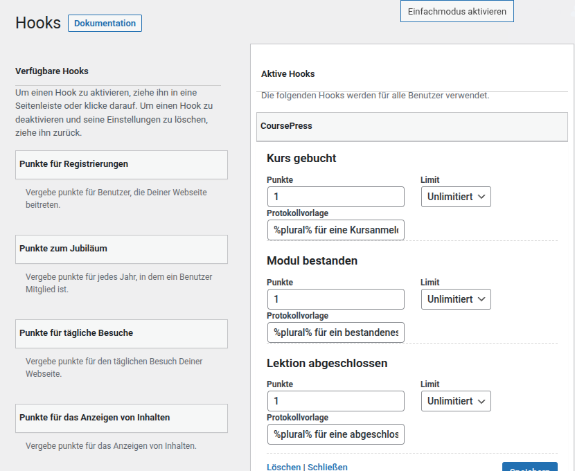

# Hooks für andere Plugins

BoniPress kann Aktionen anderer Plugins mit Punkten verbinden. Ein Integrations-Hook erscheint unter **BoniPress → Hooks**, wenn die jeweilige Integration verfügbar ist. Installation und Aktivierung des anderen Plugins allein aktivieren noch keine Punktevergabe: Richte zusätzlich den Hook ein.

## Einrichten und testen

1. Installiere und aktiviere das benötigte Plugin und richte dessen Grundfunktionen ein.
2. Öffne **BoniPress → Hooks**, wähle den passenden Punkttyp und verschiebe den Integrations-Hook zu **Aktive Hooks**.
3. Lege für die gewünschten Ereignisse Punkte, Limits und Protokollvorlagen fest und speichere den Hook. Ein negativer Betrag kann einen Abzug darstellen; beachte die Hinweise der jeweiligen Felder.
4. Führe die Aktion mit einem nicht ausgeschlossenen Testkonto aus und kontrolliere das [Protokoll](https://psource.eimen.net/wiki/bonipress-protokoll/). Teste auch Stornierungen oder Löschungen, falls Du dafür Regeln gesetzt hast.

Die genauen Einstellfelder hängen vom Hook und den aktiven Plugins ab. Die [allgemeine Hook-Anleitung](https://psource.eimen.net/wiki/bonipress-hooks/) erklärt Aktivierung, Speicherung und Deaktivierung.

## Community und Foren

* **PS Community:** Regeln für Aktivitäten und Kommentare, Forenthemen und Antworten, Gruppen sowie Freundschaften. Für mehrere Aktionen gibt es getrennte Regeln für Erstellen und Entfernen.
* **BuddyPress – Mitglieder:** unter anderem Profilaktivitäten, Profilbilder, Freundschaften und Kommentare.
* **BuddyPress – Gruppen:** gruppenbezogene Aktionen; negative Werte können Punkte abziehen, `0` deaktiviert die jeweilige Aktion.
* **rtMedia-Galerien:** Regeln für Upload und Löschung von Fotos, Videos und Musik.
* **PSForum:** unter anderem Foren, Themen, Favoriten und Antworten.
* **Simple:Press:** Themen und Themenbeiträge, jeweils auch beim Löschen.

Prüfe bei solchen Regeln insbesondere, ob die Beträge für Erstellung und Löschung zu Deinem gewünschten Verhalten passen.

## Formulare, Bewertungen und Empfehlungen

* **Contact Form 7:** erfolgreiche Formulareinreichungen angemeldeter Benutzer; Einstellungen werden je Formular angeboten.
* **Gravity Forms:** erfolgreiche Formulareinreichungen; Einstellungen werden je Formular angeboten.
* **WooCommerce:** Produktbewertungen.
* **WP-PostRatings:** Bewertungen von Inhalten; je nach Einstellung können bewertender Benutzer und Inhaltsautor berücksichtigt werden.
* **WP Favorite Posts:** Hinzufügen und Entfernen von Favoriten.
* **WP-Polls:** Teilnahme an Umfragen.
* **Invite Anyone:** Einladungen senden und angenommene Einladungen.
* **AffiliateWP:** Partnerregistrierungen, geworbene Besucher und vermittelte Verkäufe.
* **Jetpack:** Website- und Kommentarabonnements.
* **BadgeOS:** Standardregeln für Erfolge und deren Widerruf; Einstellungen einzelner Erfolgstypen können die Standardwerte überschreiben.

## Kurse, Mitgliedschaften und Veranstaltungen

* **CoursePress:** Kurs gebucht, Modul bestanden und Lektion abgeschlossen können jeweils eigene Beträge, Limits und Protokollvorlagen erhalten.
* **PS Mitgliedschaften:** abgeschlossene Registrierung und bezahlte Mitgliedschaftsrechnung.
* **Events and Bookings:** Veröffentlichung einer Veranstaltung, Teilnahmezusage und bezahlte Buchung.
* **Events Manager:** Teilnahme an einer Veranstaltung und Stornierung.

Teste diese Vorgänge mit einer geeigneten Testkonfiguration des jeweiligen Plugins. Unterschiedliche Versionen oder zusätzliche Erweiterungen können den Ablauf beeinflussen; die bloße Anzeige eines Hooks bestätigt noch nicht, dass die gesamte Integration in Deiner Kombination funktioniert.
