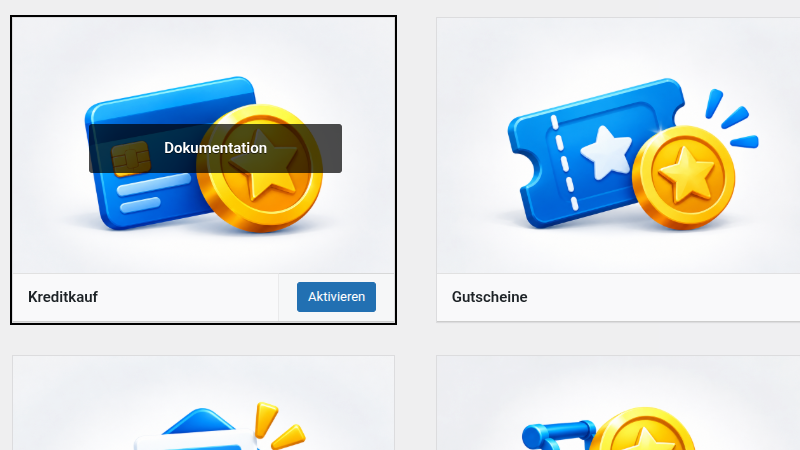
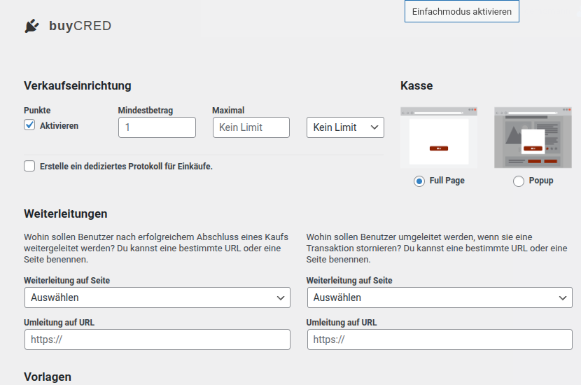
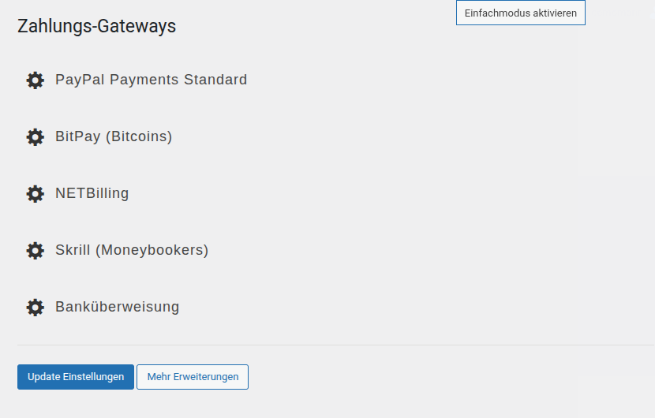
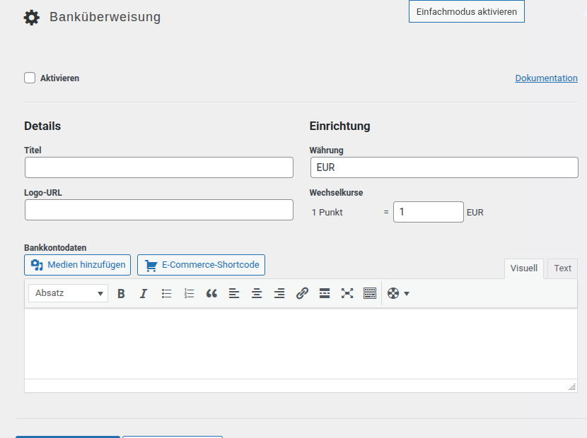

# Kreditkauf und Zahlungsarten

Mit der Erweiterung **Kreditkauf** können Benutzer Punkte erwerben. Die Einrichtung eines Zahlungsanbieters allein genügt nicht: Auch der gewünschte Punkttyp muss für den Verkauf freigegeben und eine Kaufmöglichkeit auf der Website eingebunden werden.

## Verkauf einrichten

1. Aktiviere **Kreditkauf** unter **BoniPress → Erweiterungen**.
2. Öffne **BoniPress → Einstellungen → buyCRED**. Aktiviere die gewünschten Punkttypen und lege Mindestbetrag und gegebenenfalls ein Kaufmaximum mit Zeitraum fest.
3. Wähle die Kassenansicht und prüfe Weiterleitungen, Protokollvorlagen sowie die Option, Punkte für andere Benutzer zu kaufen. Speichere die BoniPress-Einstellungen.
4. Öffne den separaten Menüpunkt **Zahlungs-Gateways**, klappe die gewünschte Zahlungsart auf und richte sie ein. Aktiviere sie mit dem zugehörigen Kontrollkästchen und speichere mit **Update Einstellungen**. Achte auf Währung und Wechselkurs: Prüfe anhand eines kleinen Beispiels, welchen Geldbetrag ein bestimmter Punktekauf tatsächlich kostet.
5. Binde eine Kaufmöglichkeit ein, etwa über die verfügbaren Shortcodes `[bonips_buy]` oder `[bonips_buy_form]`, und teste den vollständigen Ablauf.

## Zahlungsarten

Die Oberfläche enthält Einstellungen für **PayPal Payments Standard**, **BitPay**, **NETBilling**, **Skrill** und **Banküberweisung**. Bei den Online-Anbietern gibt es einen **Sandbox Modus**; Banküberweisung hat keinen solchen Schalter. Ob ein Anbieter und seine Schnittstelle für Dein Konto und Deine eingesetzte Version noch nutzbar sind, musst Du vor dem produktiven Einsatz beim Anbieter und mit einem vollständigen Test prüfen.

* **PayPal Payments Standard:** Konto-E-Mail, Artikelname, optionales Logo, Währung und Wechselkurs.
* **BitPay:** API-Token beziehungsweise Kopplung, Artikelname, optionales Logo, Transaktionsgeschwindigkeit, Benachrichtigungen, Währung und Wechselkurs.
* **NETBilling:** Konto-ID, Website-Tag und Integritätsschlüssel sowie Währung und Wechselkurs. Beachte die angezeigte Postback-CGI-URL.
* **Skrill:** Konto-E-Mail und Geheimwort sowie Artikelname, Währung und Wechselkurs; zusätzliche Texte können für die Kassenseite gesetzt werden.
* **Banküberweisung:** Titel, Währung, Wechselkurs und Bankkontodaten. Der Kauf zeigt Überweisungsinformationen an; prüfe Zahlungseingänge und ausstehende Zahlungen vor einer manuellen Gutschrift sorgfältig.

Bewahre Zugangsdaten und Schlüssel vertraulich auf. Verwende Testkonten und Sandbox-Zugangsdaten ausschließlich im Testmodus. Prüfe für Online-Zahlungen auch, ob Zahlungsbestätigungen den Server erreichen und genau eine korrekte Gutschrift erfolgt. Teste Abbruch, fehlgeschlagene Zahlung und gegebenenfalls Rückerstattung. Wechsle erst nach erfolgreicher Prüfung in den Produktivmodus.

Unter **Ausstehende Zahlungen** können offene Käufe geprüft werden. Der Shortcode `[bonips_buy_pending]` ist für die Anzeige ausstehender Käufe verfügbar.
