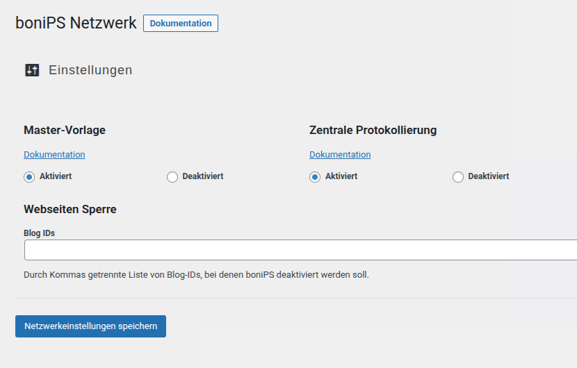

# BoniPress im Multisite-Netzwerk

Bei netzwerkweit aktiviertem BoniPress können Netzwerkadministratoren in der **Netzwerkverwaltung → BoniPress → Netzwerkeinstellungen** Einstellungen für das Netzwerk vornehmen.

## Master-Vorlage

Ist die **Master-Vorlage** aktiviert, werden Einstellungen der Hauptwebsite für die Websites im Netzwerk verwendet. Richte BoniPress daher zuerst auf der Hauptwebsite ein und prüfe die Wirkung auf einer Testwebsite. Ohne Master-Vorlage werden die Websites eigenständig eingerichtet.

## Zentrale Protokollierung

Mit **Zentrale Protokollierung** wird das Protokoll zentral geführt. Ohne diese Option werden lokale Protokolle verwendet. Prüfe vor einer Umstellung, wo bestehende Einträge liegen und welche Auswertungen davon abhängen. Erstelle vorher eine Datenbanksicherung.

## Einzelne Websites sperren

Unter **Webseiten Sperre → Blog IDs** trägst Du die IDs der Websites ein, auf denen BoniPress deaktiviert sein soll. Trenne mehrere IDs durch Kommas. Es handelt sich um Website-IDs, nicht um Benutzer-IDs.

Speichere Änderungen mit **Netzwerkeinstellungen speichern** und kontrolliere anschließend Hauptwebsite und betroffene Unterseiten. In sehr großen Netzwerken weist die Oberfläche darauf hin, dass diese Funktionen nicht verwendet werden können.
