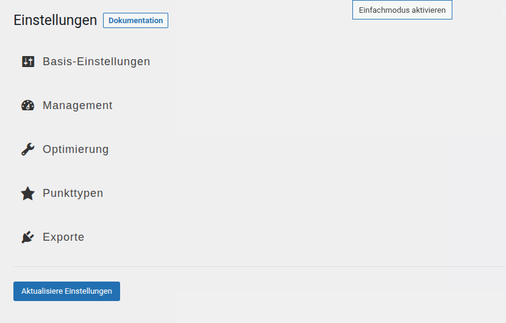

# Optimierung und Aufbewahrung

Unter **BoniPress → Einstellungen → Optimierung** steuerst Du Caches für Verlauf und Bestenlisten sowie das automatische Löschen von Protokolleinträgen.

## Verlauf und Bestenlisten zwischenspeichern

Für beide Bereiche stehen getrennte Einstellungen zur Verfügung:

* **Kein Caching:** Die Anzeige wird nicht über diesen Cache zwischengespeichert.
* **Bei Guthabenänderung leeren:** Der Cache wird bei Änderungen am Guthaben geleert.
* **Einmal täglich leeren:** Die Anzeige kann bis zur nächsten täglichen Leerung ältere Daten zeigen.
* **Manuell löschen:** Der Cache bleibt bestehen, bis er manuell geleert wird.

Wähle die Einstellung passend zu Deiner Website: Häufige Aktualisierung hält Anzeigen aktueller, während Caching wiederholte Abfragen reduzieren kann. Prüfe nach einer Änderung die tatsächliche Anzeige.

## Alte Protokolleinträge automatisch löschen

Gib bei **Protokolleinträge automatisch löschen** die Anzahl der Tage ein, nach der alte Einträge gelöscht werden sollen. `0` deaktiviert die automatische Löschung. Speichere anschließend mit **Aktualisiere Einstellungen**.

**Achtung:** Gelöschte Einträge fehlen im Verlauf und können Auswertungen oder Funktionen beeinflussen, die frühere Buchungen und Limits anhand des Protokolls überprüfen. Eine Cache-Leerung ist nicht dasselbe wie das Löschen von Protokolleinträgen. Sichere Datenbank und Protokoll vor Änderungen und beachte Deine Aufbewahrungspflichten.
