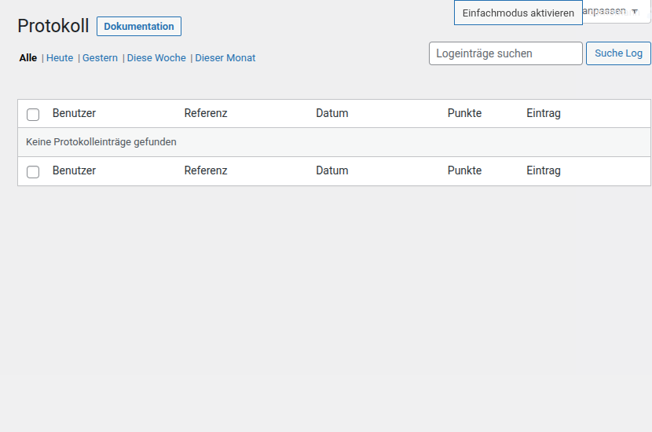

# Das Punkteprotokoll

Unter **BoniPress → Protokoll** kannst Du nachvollziehen, welche Punktebuchungen erfasst wurden. Das Protokoll ist besonders hilfreich, wenn ein Guthaben unerwartet aussieht oder Du eine neue Punkte-Regel testest.

## Einträge finden

1. Wähle oberhalb der Tabelle einen Zeitraum, zum Beispiel **Heute**, **Gestern**, **Diese Woche** oder **Dieser Monat**. Mit **Alle** entfernst Du diesen Zeitfilter.
2. Gib bei Bedarf einen Suchbegriff ein und klicke auf **Suche Log**.
3. Prüfe **Benutzer**, **Referenz**, **Datum**, **Punkte** und **Eintrag**. Die Referenz bezeichnet die Art des Ereignisses; der Eintrag beschreibt die Buchung.

Ein leeres Ergebnis kann bedeuten, dass noch keine passenden Buchungen existieren. Prüfe Zeitraum und Suche und führe gegebenenfalls eine Testaktion aus. Bei mehreren Punkttypen achte darauf, den richtigen Typ zu betrachten.

## Vor dem Löschen

Das Löschen eines Protokolleintrags ist nicht gleichbedeutend mit einer Korrektur des Guthabens. Alte Einträge können auch für Verlauf, Auswertungen und Limits relevant sein. Sichere Deine Daten vor Massenaktionen und lies die Hinweise zur [automatischen Löschung](https://psource.eimen.net/wiki/bonipress-optimierung/).

Einträge und Guthaben lassen sich getrennt importieren; Einzelheiten stehen in der [Import-Anleitung](https://psource.eimen.net/wiki/bonipress-import/).
